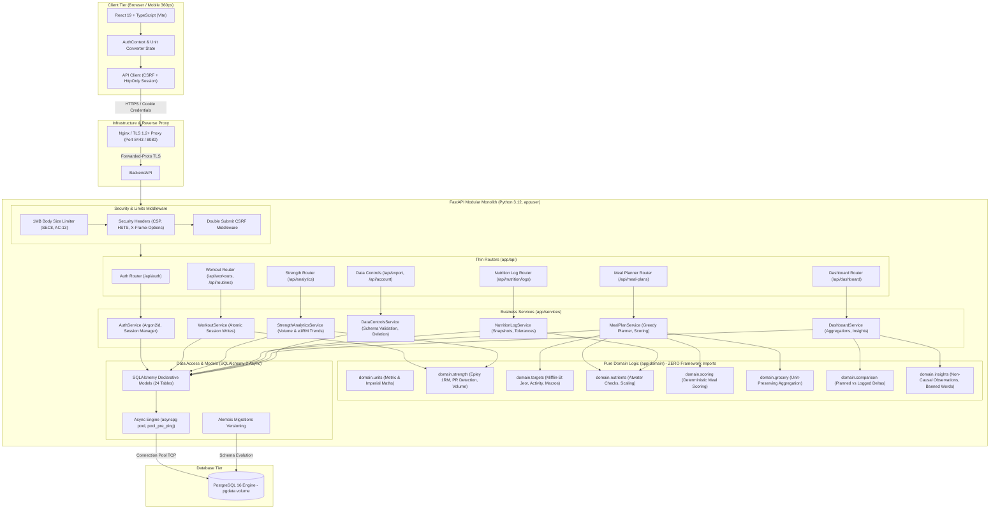

# System Architecture Diagram

Comprehensive architectural diagram detailing layer boundaries, security middleware, pure domain modules, and deployment topology (AC-115).

## 1. Application Layer Hierarchy & Boundaries (Rule AC-98, D-01, D-17)

---

## 2. Architectural Principles & Constraints

1. **Strict Layering (AC-98):**
   - The `app/domain` package is mathematically pure: it contains zero imports of `fastapi`, `sqlalchemy`, `pydantic`, `datetime.utcnow`, or any network/database library. Tested by `tests/test_layering.py`.
2. **Atomic Multi-Row Writes (NFR Reliability):**
   - Workouts, routines, meal plan substitutions, and nutrition intake logs commit in atomic transactions. A failure on a set or ingredient rolls back the entire session.
3. **Defense in Depth Security (SEC1–SEC12):**
   - Argon2id password hashing with unique salt.
   - HttpOnly, SameSite=Lax session cookies preventing token theft via XSS.
   - Double-submit CSRF protection on all mutating endpoints (`POST`, `PATCH`, `DELETE`).
   - Rate limiting on failed authentication attempts.
   - 1 MB request body hard limit.
4. **Data Sovereignty (AC-88, AC-89):**
   - Full JSON export validated against `export_schema.json`.
   - Permanent account deletion wiping all 16 user-owned tables while preserving shared catalogue data.
