# Entity-Relationship (ER) Diagram

Complete relational database schema diagram for the **Gym Workout Logger & Strength-Focused Diet Planner** (AC-115).

```mermaid
erDiagram
    USERS ||--o| USER_PROFILES : "has"
    USERS ||--o{ SESSIONS : "authenticates"
    USERS ||--o{ USER_FOOD_CONSTRAINTS : "declares"
    USERS ||--o{ USER_CUISINE_PREFERENCES : "prefers"
    USERS ||--o{ NUTRITION_GOALS : "defines"
    USERS ||--o{ WORKOUT_ROUTINES : "owns"
    USERS ||--o{ WORKOUT_SESSIONS : "logs"
    USERS ||--o{ MEAL_PLANS : "generates"
    USERS ||--o{ NUTRITION_LOGS : "consumes"

    WORKOUT_ROUTINES ||--o{ ROUTINE_EXERCISES : "contains"
    EXERCISES ||--o{ ROUTINE_EXERCISES : "targets"
    EXERCISES ||--o{ WORKOUT_EXERCISES : "performs"

    WORKOUT_SESSIONS ||--o{ WORKOUT_EXERCISES : "contains"
    WORKOUT_EXERCISES ||--o{ WORKOUT_SETS : "records"
    WORKOUT_ROUTINES ||--o{ WORKOUT_SESSIONS : "instantiates"

    FOODS ||--o{ FOOD_NUTRIENTS : "measured_as"
    FOODS ||--o{ FOOD_ALLERGENS : "contains"
    FOODS ||--o{ RECIPE_INGREDIENTS : "used_in"
    RECIPES ||--o{ RECIPE_INGREDIENTS : "composed_of"
    RECIPES ||--o{ RECIPE_DIET_TAGS : "tagged_with"
    RECIPES ||--o{ RECIPE_MEAL_TYPES : "allowed_for"

    MEAL_PLANS ||--o{ PLANNED_MEALS : "schedules"
    RECIPES ||--o{ PLANNED_MEALS : "assigned_to"
    PLANNED_MEALS ||--o{ PLANNED_MEAL_ITEMS : "decomposes_into"
    FOODS ||--o{ PLANNED_MEAL_ITEMS : "references"
    RECIPES ||--o{ PLANNED_MEAL_ITEMS : "references"

    NUTRITION_LOGS ||--o{ NUTRITION_LOG_ITEMS : "logs"
    FOODS ||--o{ NUTRITION_LOG_ITEMS : "eaten_as"
    RECIPES ||--o{ NUTRITION_LOG_ITEMS : "eaten_as"

    USERS {
        uuid id PK
        string email UK
        string password_hash
        boolean is_active
        timestamp created_at
        timestamp updated_at
    }

    USER_PROFILES {
        uuid user_id PK,FK
        string display_name
        date birth_date
        decimal height_cm
        decimal body_weight_kg
        string timezone
        string units
        timestamp adult_confirmed_at
        boolean needs_professional_guidance
        boolean calories_hidden
        boolean nutrition_paused
        boolean track_body_weight
        string goal
        string activity_level
    }

    SESSIONS {
        uuid id PK
        uuid user_id FK
        string session_token_hash UK
        string csrf_token
        timestamp created_at
        timestamp expires_at
        boolean is_revoked
    }

    USER_FOOD_CONSTRAINTS {
        uuid id PK
        uuid user_id FK
        string constraint_type
        string value
    }

    USER_CUISINE_PREFERENCES {
        uuid id PK
        uuid user_id FK
        string cuisine_code
        integer preference_level
    }

    EXERCISES {
        uuid id PK
        string name UK
        string primary_muscle
        string equipment
        string movement_pattern
        text instructions
        uuid owner_user_id FK "nullable for system"
    }

    WORKOUT_ROUTINES {
        uuid id PK
        uuid user_id FK
        string name
        text description
    }

    ROUTINE_EXERCISES {
        uuid id PK
        uuid routine_id FK
        uuid exercise_id FK
        integer order_index
        integer target_sets
        integer rep_min
        integer rep_max
        integer rest_seconds
    }

    WORKOUT_SESSIONS {
        uuid id PK
        uuid user_id FK
        uuid routine_id FK
        timestamp started_at
        timestamp completed_at
        text notes
    }

    WORKOUT_EXERCISES {
        uuid id PK
        uuid session_id FK
        uuid exercise_id FK
        integer order_index
        text notes
    }

    WORKOUT_SETS {
        uuid id PK
        uuid workout_exercise_id FK
        integer set_number
        integer reps
        decimal load_kg
        decimal rpe
        boolean is_warmup
        timestamp completed_at
    }

    FOODS {
        uuid id PK
        string name UK
        string food_category
        string serving_description
        decimal default_serving_g
        boolean approximate
        boolean allergens_verified
        string data_source
    }

    FOOD_NUTRIENTS {
        uuid id PK
        uuid food_id FK
        string nutrient_code
        decimal amount_per_100g
        string unit
    }

    FOOD_ALLERGENS {
        uuid food_id PK,FK
        string allergen_code PK
    }

    RECIPES {
        uuid id PK
        string name UK
        string cuisine_code
        integer prep_time_minutes
        integer cook_time_minutes
        decimal default_servings
        integer cost_minor_per_serving
    }

    RECIPE_INGREDIENTS {
        uuid id PK
        uuid recipe_id FK
        uuid food_id FK
        decimal quantity
        string unit
    }

    RECIPE_DIET_TAGS {
        uuid recipe_id PK,FK
        string diet_tag PK
    }

    RECIPE_MEAL_TYPES {
        uuid recipe_id PK,FK
        string meal_type PK
    }

    NUTRITION_GOALS {
        uuid id PK
        uuid user_id FK
        date effective_from
        integer calorie_target_kcal
        integer protein_target_g
        integer carbs_target_g
        integer fat_target_g
        text rationale
    }

    MEAL_PLANS {
        uuid id PK
        uuid user_id FK
        string name
        date start_date
        date end_date
        string status
        json target_snapshot
    }

    PLANNED_MEALS {
        uuid id PK
        uuid meal_plan_id FK
        date plan_date
        string meal_type
        uuid recipe_id FK
        string title
        decimal servings
        integer sort_order
    }

    PLANNED_MEAL_ITEMS {
        uuid id PK
        uuid planned_meal_id FK
        uuid food_id FK
        uuid recipe_id FK
        decimal quantity
        string unit
        json nutrient_snapshot
    }

    NUTRITION_LOGS {
        uuid id PK
        uuid user_id FK
        timestamp consumed_at
        string meal_type
        string source_type
        text notes
    }

    NUTRITION_LOG_ITEMS {
        uuid id PK
        uuid nutrition_log_id FK
        uuid food_id FK
        uuid recipe_id FK
        decimal quantity
        string unit
        json nutrient_snapshot
    }
```

---

## Key Relational Guarantees

1. **Foreign Key Deletion Cascades:**
   - Deleting a `User` cascades to delete all child rows across `sessions`, `user_profiles`, `user_food_constraints`, `user_cuisine_preferences`, `nutrition_goals`, `workout_routines`, `workout_sessions`, `meal_plans`, and `nutrition_logs`.
   - Shared catalogue entities (`foods`, `recipes`, system `exercises`) are protected with `ON DELETE RESTRICT` to prevent orphan references and guarantee catalogue immutability.
2. **Deterministic Versioning:**
   - `planned_meal_items` and `nutrition_log_items` embed an immutable `nutrient_snapshot` (JSON) to ensure historical logs never alter when catalogue foods are edited or re-verified.
3. **High-Performance Composite Indices:**
   - `idx_workout_sessions_user_started` on `(user_id, started_at)` enables $O(\log N)$ cursor pagination under 100ms for multi-year logs.
   - `idx_nutrition_logs_user_consumed` on `(user_id, consumed_at)` powers date-range filtering in user-local timezones.
