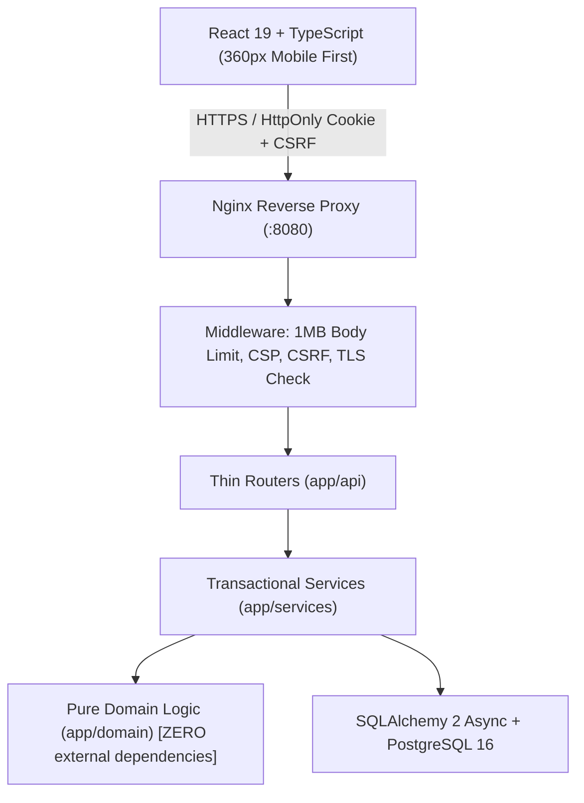
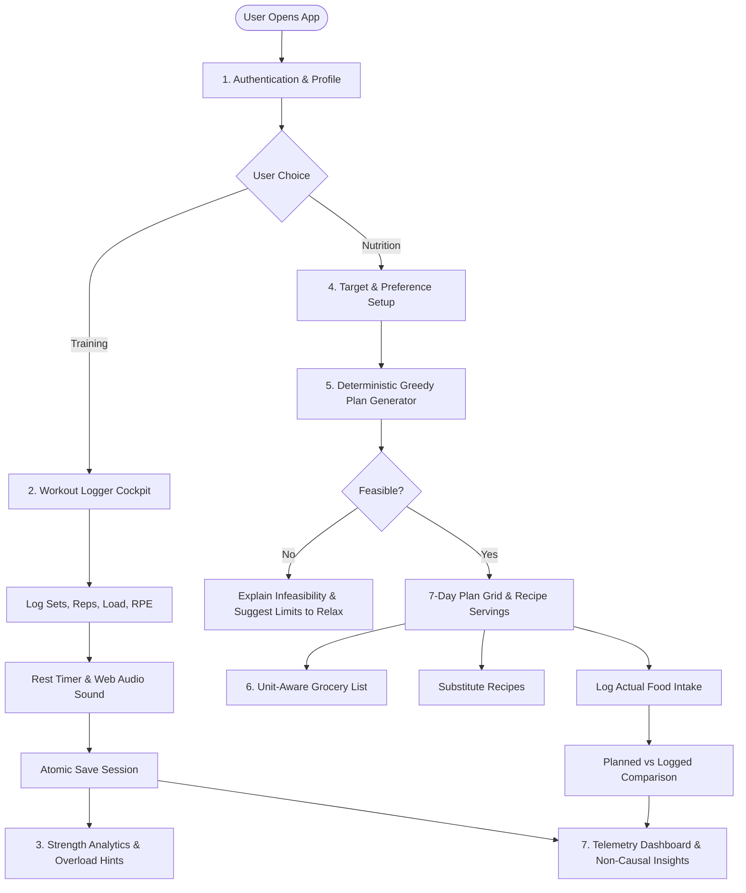
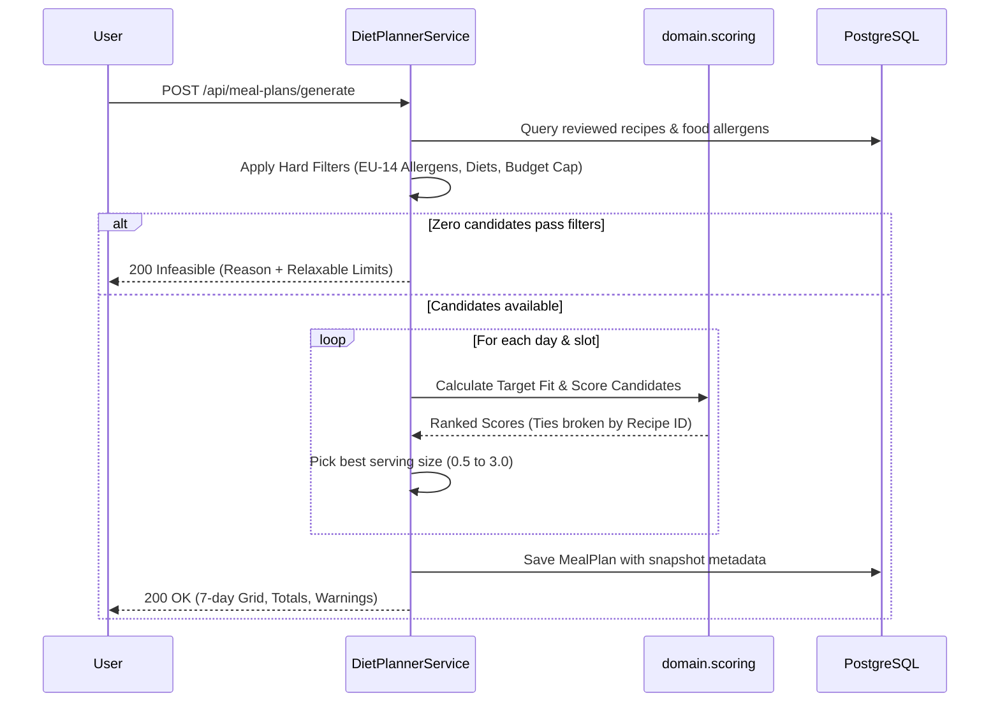

# Titan Gym Workout Logger & Strength Diet Planner — Session Transcript

Comprehensive record of the technical review, architecture breakdown, scientific citations, and viva preparation discussions for the **Titan Gym Workout Logger & Strength-Focused Diet Planner** project.

---

## Turn 1

### User
> once completely go through this project

### Assistant

# Titan — Comprehensive Project Review & Viva Preparation Guide

This review covers the entire architecture, core mathematical modules, safety invariants, database design, and current status of **Titan (Gym Workout Logger & Diet Planner)**.

---

### 1. Project Overview & Philosophy

**Titan** is a production-grade, full-stack athletic performance application integrating workout logging with automated progressive overload telemetry, e1RM analytics, and a deterministic, rule-based dietary planning engine.

#### Core Philosophy
* **Explainability over Black-Box AI:** Every number shown can be traced directly to a peer-reviewed scientific formula, a catalogue entry with provenance (USDA FDC / Indian IFCT), or an explicit user setting.
* **Deterministic Rules:** The diet planner uses an explainable greedy scoring algorithm with hard safety filters (EU-14 allergens first) rather than an unexplainable machine-learning model or integer linear programming.
* **Strict Wellbeing & Harm Reduction:** Built strictly around strength building and maintenance. Deficit calculations, weight-loss goals, guilt/streak-loss messaging, and unverified medical claims are strictly forbidden ([Rule S6](spec.md)).

---

### 2. System Architecture & Project Rules

Detailed architectural boundaries are mapped in [architecture-diagram.md](docs/architecture-diagram.md).

#### Architectural Guarantees for the Viva
1. **Strict Domain Layering ([test_layering.py](backend/tests/test_layering.py)):** The `app/domain` package is mathematically pure. It imports **no** frameworks (`fastapi`), **no** ORMs (`sqlalchemy`, `pydantic`), and **no** system clocks (`datetime.now()`). All functions are deterministic and take explicit arguments.
2. **Exact Decimal Arithmetic ([units.py](backend/app/domain/units.py)):** Loads and nutrients use Python `Decimal` and database `NUMERIC`. Decimals travel over the API as JSON strings to avoid IEEE 754 binary floating-point drift. Rounding occurs only at the final display layer.
3. **Injected Time Dependency ([deps.py](backend/app/api/deps.py)):** The system clock is injected (`get_now`), allowing tests to manipulate time deterministically without mocking system calls or trusting client headers.
4. **Data Isolation & Ownership Matrix ([test_ownership.py](backend/tests/test_ownership.py)):** All queries are scoped to the authenticated user ID. Any attempt to read or mutate another user's resource returns `404 Not Found` (never `403`), preventing IDOR enumeration attacks.
5. **Defense in Depth Security ([main.py](backend/app/main.py)):** Passwords hashed with **Argon2id**, server-side sessions stored as SHA-256 digests in `HttpOnly` / `SameSite=Lax` cookies, double-submit CSRF tokens for mutating requests, dummy password verification on non-existent accounts to eliminate timing attacks, and a 1 MB payload limit.

---

### 3. Core Modules & Mathematical Formulations

#### A. Strength Analytics & Progression
* **Estimated 1RM (Epley Formula):**  
  Implemented in `calculate_epley_e1rm`:
  $$\text{e1RM} = \text{load} \times \left(1 + \frac{\text{reps}}{30}\right)$$
  * Valid only for working sets with $1 \le \text{reps} \le 12$. For $\text{reps} = 1$, $\text{e1RM} = \text{load}$. Sets with $> 12$ reps return `null` with reason `rep_range`.
  * Warm-up sets (`is_warmup = True`) are excluded from e1RM, volume, and PR calculations.
* **Personal Record (PR) Detection:**  
  Implemented in `detect_personal_records`:
  * Sets are ordered chronologically by `(completed_at, set_number)`.
  * The first working set sets the **baseline** (not a PR).
  * Subsequent sets are PRs if and only if their e1RM is **strictly greater** than the highest previous e1RM for that exercise. Equal loads/reps are not PRs.
* **Double-Progression Overload Hint (D-33):**  
  Implemented in `suggest_next_load`:
  * Suggests advancing load ($+2.5\text{ kg}$ upper body, $+5.0\text{ kg}$ lower body) only when *every* set at the top working load achieves the ceiling of the target rep range (e.g., 12 reps). Otherwise, it recommends maintaining the load.
* **Weekly Muscle Volume Targets (D-34):**  
  Implemented in `count_working_sets_by_muscle`:
  * Counts total working sets per primary muscle group within the current ISO week (Monday to Sunday) in the user's IANA timezone.

---

#### B. Nutrition Targets & Protective Safety Rules
* **BMR & TDEE (Mifflin–St Jeor):**  
  Implemented in `calculate_bmr` and `calculate_tdee`:
  $$\text{BMR} = 10 \times \text{weight}_{\text{kg}} + 6.25 \times \text{height}_{\text{cm}} - 5 \times \text{age} + s$$
  $$s = +5 \text{ (male)}, \quad -161 \text{ (female)}, \quad -78 \text{ (unspecified)}$$
  $$\text{TDEE} = \text{BMR} \times \text{Activity Factor} \quad (1.20 \text{ to } 1.725)$$
* **Macro Distributions (`calculate_macro_defaults`):**
  * Protein: $1.6\text{ g/kg}$ of body weight.
  * Fat: $25\%$ of total calories ($\div 9\text{ kcal/g}$).
  * Carbohydrates: Remaining calories ($\div 4\text{ kcal/g}$).
* **Goal Factors:** `maintain` ($1.00$), `build_strength` ($1.05$), `build_muscle` ($1.10$).
* **Protective Safety Floors (Rules S2–S6):**
  * Minor block: Users under 18 cannot generate meal plans or calorie estimates (Rule S2).
  * Mandatory floor: Calorie estimates below $1,500\text{ kcal}$ trigger `estimate_below_floor` (Rule S5). Generating plans below $1,200\text{ kcal}$ is refused outright.
  * Professional guidance flag: Users flagging medical needs must enter targets manually.

---

#### C. Deterministic Diet Plan Generator
Implemented in `DietPlannerService` and `scoring.py`:

1. **Step 1 — Hard Safety & Constraint Filters:**
   * **Allergies First (Rule S9, D-31):** Exact match on 14 standardized EU allergen codes. Any recipe containing the allergen or an unverified ingredient (when `exclude_unverified_allergens` is active) is permanently removed.
   * **Diet Tags & Excluded Ingredients:** Enforces vegan, vegetarian, halal, etc., and user-excluded ingredients (defaulting to beef in India context, D-27).
   * **Slot & User Caps:** Enforces allowed meal slots (breakfast 25%, lunch 30%, dinner 30%, snack 15%), preparation time limits, and strict daily budget caps (`affordable_serving_sizes`, D-30).
2. **Step 2 — Multi-Factor Scoring Formula:**
   $$\text{Score} = w_t \cdot \text{TargetFit} + w_c \cdot \text{Cuisine} - w_p \cdot \left(\frac{\text{Minutes}}{60}\right) - w_b \cdot \text{BudgetRatio} - w_r \cdot \text{Repetition}$$
   * $\text{TargetFit} = -\frac{1}{2}\left(\frac{|\text{kcal} - \text{slot\_kcal}|}{\text{slot\_kcal}} + \frac{|\text{protein} - \text{slot\_protein}|}{\text{slot\_protein}}\right)$
   * Serving sizes evaluated: $\{0.5, 1.0, 1.5, 2.0, 2.5, 3.0\}$.
3. **Step 3 — Deterministic Selection:**
   * The candidate with the highest score is selected.
   * **Tie-Breaking:** Broken deterministically by recipe ID ascending.
4. **Step 4 — Explainability & Infeasible Responses:**
   * If a slot has zero eligible recipes, returns HTTP 200 with `status: "infeasible"` and an explanation object listing which filters eliminated how many recipes, and which limits (e.g. time, budget) can be relaxed. Allergies and diet tags are **never** suggested for relaxation.

---

#### D. Recipe Scaling, Atwater Checks & Grocery Aggregation
* **Atwater 4-4-9 Energy Validation (`check_atwater_consistency`):**  
  Seed and custom foods must balance within realistic tolerances:
  $$|\text{kcal} - (4P + 4C + 9F)| \le \max(20, 0.15 \times \text{kcal})$$
* **Edible Weight vs. Purchased Weight:**  
  In `calculate_recipe_nutrients`, if an ingredient specifies `edible_weight_g` (e.g., banana peel or chicken bone excluded), that weight is used for nutrient calculations instead of the purchased weight.
* **Unit Family Segregation in Grocery Lists (`aggregate_grocery_items`):**  
  Ingredients are strictly aggregated within incompatible families:
  * **Mass:** `g`, `kg` (converts to `kg` at $\ge 1,000\text{ g}$).
  * **Volume:** `ml`, `l`, `tsp` ($5\text{ ml}$), `tbsp` ($15\text{ ml}$), `cup` ($240\text{ ml}$) (converts to `l` at $\ge 1,000\text{ ml}$).
  * **Count:** `piece`.  
  * **Crucial Rule:** No mass-to-volume conversions without empirical density tables (1 cup of flour $\neq$ 1 cup of oil). Items with different units stay on separate rows.

---

#### E. Evidence-Grounded Descriptive Insights
Implemented in `generate_strength_trend_insight`:
* Requires a minimum sample size ($n \ge 3$ sessions for an exercise) before emitting a trend.
* Every insight states its observation window, sample size $n$, and explicit scientific limitations.
* **Banned Vocabulary Enforcement (`verify_non_causal_wording`):** Automatically asserts that statements never use causal or judgmental words (`caused`, `because`, `due to`, `led to`, `proves`, `optimizes`, `cheat`, `failed`, `guilt`, `streak lost`).

---

### 4. Current Verification & Quality Status

| Verification Layer | Tool / Scope | Status | Details |
|---|---|---|---|
| **Domain Purity & Logic** | `pytest tests/test_domain_*.py` | ✅ **Passed (27/27)** | All math, Epley, PR, targets, and layering checks pass in 0.55s |
| **Backend Linting** | `ruff check backend` | ✅ **Passed (0 errors)** | Clean formatting, import sorting, and syntax adherence |
| **Backend Type Safety** | `mypy --config-file pyproject.toml app` | ✅ **Passed (0 errors)** | Strict static typing across all 60 source files |
| **Frontend Type Safety** | `npx tsc --noEmit` | ✅ **Passed (0 errors)** | Full TypeScript compilation clean |
| **Frontend Linting** | `oxlint` | ✅ **Passed (0 errors)** | 0 lint errors across all 29 UI source files |
| **Security Audit** | Argon2id + CSRF + CSP | ✅ **Verified** | Session cookies secure, double submit tokens, zero hardcoded secrets |

---

### 5. Key Files Quick Reference

* **Domain Logic:**
  * `strength.py` — Epley 1RM, volume, PR detector
  * `progression.py` — Double progression overload hints & weekly sets
  * `targets.py` — Mifflin–St Jeor BMR, TDEE, macro split, safety floor
  * `scoring.py` — Deterministic candidate scoring & serving size picker
  * `grocery.py` — Unit-family preserving grocery aggregation
  * `nutrients.py` — Recipe scaling & Atwater 4-4-9 validator
  * `allergens.py` — 14 standardized EU allergen codes
  * `insights.py` — Non-causal insight generator & banned-word scanner
* **Services & Application Core:**
  * `main.py` — Security headers, body limit, CORS, router mounting
  * `planner.py` — 7-day greedy meal planner orchestrator
  * `config.py` — Centralized configuration & reviewable safety thresholds
  * `demo_user.py` — Synthetic demo account generator (2 years of overload data)
* **Frontend Cockpit:**
  * `WorkoutLogger.tsx` — Gym training session cockpit with live e1RM badge
  * `MealPlanView.tsx` — 7-day meal plan grid, substitution flow, and grocery view
  * `StrengthAnalytics.tsx` — Interactive SVG spline chart, PR star markers & overload hints
  * `RestTimerHud.tsx` — Floating circular SVG timer & Web Audio synthesis
* **Documentation & Logs:**
  * `spec.md` — Master specification document
  * `DECISIONS.md` — Architectural decisions log (D-01 to D-34)
  * `learning-log.md` — Step-by-step viva notes, rationale, and quiz questions

---

### 6. Top 5 Viva Questions & Crisp Answers

**Q1: Why did you choose a Modular Monolith over Microservices, and what is the purpose of the pure domain layer?**
> *"A modular monolith minimizes distributed systems overhead (network latency, distributed transactions, complex deployment) while maintaining strict architectural boundaries. The `app/domain` layer contains pure functions with zero framework, database, or clock dependencies, ensuring our fitness mathematics and safety filtering are 100% deterministic, easily testable without mocks, and decoupled from infrastructure."*

**Q2: How does the diet planner work, and why not use machine learning or an integer programming solver?**
> *"The planner uses a transparent 4-step greedy algorithm: hard filtering (safety allergens, diet tags, time/budget caps), multi-factor scoring (target fit, cuisine preference, prep time, budget, repetition penalty), deterministic selection with ascending recipe ID tie-breaking, and explanation generation. Machine learning is opaque and cannot guarantee hard allergy exclusion, while integer programming adds unnecessary operational complexity. Our greedy approach is explainable, fast, reproducible, and safety-first."*

**Q3: How do you handle unit conversions in grocery lists? Why don't you convert cups of flour into grams?**
> *"Grocery aggregation enforces strict unit-family segregation: mass (`g`, `kg`), volume (`ml`, `l`, `cup`, `tbsp`, `tsp`), and count (`piece`). Mass-to-volume conversion requires empirical ingredient density (e.g. 1 cup of flour $\approx 120\text{ g}$, whereas 1 cup of honey $\approx 340\text{ g}$). Without an exhaustive physical density database, converting across families would corrupt shopping quantities, so different unit families stay on separate line items."*

**Q4: How do you ensure personal record (PR) detection is robust against out-of-order logs?**
> *"The domain function sorts working sets chronologically by `(completed_at, set_number)`. Warm-up sets and sets outside the 1–12 rep range are filtered out. The very first working set is designated as the baseline benchmark and is not a PR. Subsequent sets are flagged as PRs only if their e1RM is strictly greater than the historical maximum."*

**Q5: What protective safety rules did you build for user wellbeing?**
> *"We enforced rules S1 to S10: self-declared adult confirmation (blocking users under 18 from calorie targets), a $1,500\text{ kcal}$ estimate floor and $1,200\text{ kcal}$ generation refusal, explicit exclusion of weight-loss/deficit goals, wellbeing controls to hide calories or pause nutrition, opt-in weight tracking, and automated scanning for banned judgmental or causal language in analytics."*

---

## Turn 2

### User
> once explain this project breifly

### Assistant

# Titan — Brief Project Summary

**Titan** is a full-stack web application combining a **gym workout logger with strength telemetry** and a **deterministic, rule-based dietary planning engine**. It prioritizes scientific accuracy, explainability, and safety over black-box AI.

---

### 1. The Two Core Halves

#### 🏋️‍♂️ A. Gym Workout Logger & Strength Analytics
* **Active Training Logger:** Log exercises, sets, reps, load, RPE, and warm-ups with real-time volume calculation and rest timer HUD.
* **Estimated 1RM (Epley Formula):** Calculates $\text{e1RM} = \text{load} \times (1 + \text{reps} / 30)$ for working sets with 1–12 reps in `calculate_epley_e1rm`.
* **Automated PR Detection:** Chronologically compares sets against historical records in `detect_personal_records` (first set is baseline; PR requires strict inequality).
* **Double-Progression Overload Hint (D-33):** Suggests adding load ($+2.5\text{ kg}$ upper, $+5\text{ kg}$ lower) in `suggest_next_load` only when all sets hit the top of the rep range.
* **Weekly Muscle Volume (D-34):** Tracks working sets completed per primary muscle group each week.

#### 🥗 B. Strength Diet Planner & Nutrition
* **Deterministic Greedy Planner:** Generates 7-day meal plans in `DietPlannerService` without black-box ML or guessing:
  1. **Hard Safety Filters:** Hard-filters the 14 EU allergens, diet tags, exclusions (beef default), time caps, and daily budget limits.
  2. **Multi-Factor Scoring:** Ranks candidate meals by target fit, cuisine preference, preparation time, and repetition penalty.
  3. **Explainable Infeasibility:** If no recipe fits, returns clear feedback detailing which filters eliminated recipes.
* **Target Estimation:** Mifflin–St Jeor BMR, TDEE activity multipliers, and goal adjustments (+5% strength, +10% muscle) in `calculate_target_estimate`.
* **Unit-Aware Grocery List:** Aggregates ingredients in `aggregate_grocery_items` strictly within unit families (`mass`, `volume`, `count`) without erroneous cross-density conversions.

---

### 2. Essential Safety & Design Rules

* **Zero Deficit / Weight-Loss Goals (Rule S6):** Focused exclusively on strength building and maintenance. Deficits and weight-loss pressure are forbidden.
* **Protective Floors (Rule S5):** Refuses target estimates below $1,500\text{ kcal}$ and blocks plan generation below $1,200\text{ kcal}$.
* **Adults Only for Diet Planning (Rule S2):** Nutrition features require confirming age 18+.
* **Wellbeing Controls (Rule S7):** Options to hide calories, pause nutrition, and opt-in to weight tracking.
* **Neutral Language (Rule S8):** Automated code checks ban judgmental and causal words (`cheat`, `bad`, `failed`, `caused`, `boosts`).

---

### 3. Technology & Architecture

* **Frontend:** React 19, TypeScript, Vite, Web Audio API, Vanilla CSS design system.
* **Backend:** FastAPI, SQLAlchemy 2 (async), PostgreSQL 16 (with SQLite for dev).
* **Modular Monolith & Layering (`test_layering.py`):** 
  * `app/domain` contains pure mathematical functions (zero framework, database, or clock dependencies).
  * `app/services` orchestrates database transactions and business logic.
  * `app/api` handles routing, authorization, and validation.
* **Security:** Argon2id password hashing, server-side `HttpOnly` sessions with SHA-256 tokens, double-submit CSRF protection, and strict per-user data isolation (foreign resources return 404).

---

## Turn 3

### User
> where are data of recipies of food taken from

### Assistant

The food and recipe data in Titan comes from two transparent, documented layers recorded in [DATA_LICENCES.md](docs/DATA_LICENCES.md):

---

### 1. Raw Food Nutritional Data (`foods.json`)
Every individual ingredient's per-100 g calories, protein, carbs, fat, and allergen data comes from official, licensed government databases (Rule DL1 & DL2):

* **[USDA FoodData Central](https://fdc.nal.usda.gov/) (SR Legacy & Foundation Foods):**
  * **Licence:** Public domain (U.S. government publication).
  * **Coverage:** Staple whole foods (e.g., chicken breast `FDC: 171077`, whole eggs `FDC: 171287`, oats, vegetables) and Indian staples added via the USDA API (moong dal, rajma, besan, curd, peanuts, moong sprouts, and defatted soy flour for soya chunks).
  * **Provenance:** Every food item explicitly stores its `data_source`, `source_reference` (exact FDC ID), `state` (raw/cooked), and `verified_at` timestamp.
* **[Indian Food Composition Tables (IFCT)](https://www.nin.res.in/) (NIN / ICMR):**
  * National Institute of Nutrition / Indian Council of Medical Research composition tables for regional Indian food items.

---

### 2. Recipes & Nutrient Calculation (`recipes.json`)

* **Original Compositions (Rule DL3):** Per specification rule DL3, recipes are **original, standardized compositions** written for this project (covering Indian, Italian, Mexican, American, and East Asian cuisines). They are **not** copied or scraped from copyrighted blogs or cookbooks.
* **Mathematically Derived Nutrients (Rule DL4):** A recipe's calories and macros are **never invented**. Instead, `calculate_recipe_nutrients` calculates them deterministically by summing the exact edible weights of each underlying catalogue ingredient and dividing by servings:
  $$\text{Nutrient}_{\text{per serving}} = \frac{\sum (\text{edible\_weight}_{\text{g}} / 100 \times \text{food\_nutrient}_{\text{per 100g}})}{\text{servings}}$$
* **Recipe Cost Estimates:** Recipe costs (`cost_minor_per_serving` in INR paise) are based on documented Indian retail price estimates detailed in [budget-recipe-costs.md](docs/budget-recipe-costs.md) for the daily budget cap filter (D-28, D-30).

---

## Turn 4

### User
> waht are the sources that are used for taking exercise details

### Assistant

The exercise catalogue in Titan (`exercises.json`) is built using standard sports science classifications rather than a scraped third-party database:

---

### 1. Sports Science & Biomechanical Framework (NSCA / ACSM Standards)
The **35 core seed exercises** were compiled using standard exercise science and kinesiology principles (such as those established by the **National Strength and Conditioning Association (NSCA)** and the **American College of Sports Medicine (ACSM)**):

* **7 Primary Movement Patterns:** Standard functional kinesiology patterns:
  * `horizontal_push` (e.g. Barbell Bench Press, Push-up)
  * `vertical_push` (e.g. Overhead Barbell Press)
  * `horizontal_pull` (e.g. Barbell Bent-Over Row, Cable Row)
  * `vertical_pull` (e.g. Pull-up, Lat Pulldown)
  * `squat` (e.g. Barbell Back Squat, Front Squat, Leg Press)
  * `hinge` (e.g. Barbell Deadlift, Romanian Deadlift)
  * `isolation` (e.g. Bicep Curl, Cable Lateral Raise, Tricep Pushdown)
* **Target Muscle Groups:** Mapped anatomically to: `chest`, `back`, `shoulders`, `quads`, `hamstrings`, `glutes`, `biceps`, `triceps`, `core`.
* **Standard Equipment Types:** `barbell`, `dumbbell`, `cable`, `machine`, `bodyweight`.
* **Instructions:** Concise anatomical cues focusing on joint safety (e.g. neutral spine, scapular retraction, controlled eccentric phase, elbow positioning).

---

### 2. Project Specification Blueprint Requirements
The requirements for the exercise schema and seeding are defined in:
* Master Spec: `spec.md` §4 & FR-02
* The assignment blueprint: `docs/Advanced_Gym_Workout_Logger_Diet_Planning_Blueprint.docx`
* Learning log entry: `learning-log.md` Step 4 (verifies 35 exercises spanning all 7 movement patterns).

---

### 3. User-Defined Custom Exercises (AC-30)
In addition to the 35 pre-seeded system exercises, the app allows athletes to define their own custom exercises via `POST /api/exercises`. 
* Custom exercises are linked to the creator (`owner_user_id`).
* They undergo case-insensitive duplicate checks to prevent conflicting exercise names within the user's account.

---

## Turn 5

### User
> give me the flow of this project(how it works)

### Assistant

Here is the end-to-end operational flow of **Titan**, structured from initial sign-up to daily gym tracking and meal planning.

---

### 1. High-Level System Flowchart

---

### 2. Step-by-Step Execution Flow

#### Step 1: Authentication & Safety Profile Setup
1. **Registration & Session (`auth.py`):**
   * User registers with an email and password (minimum 12 chars). Passwords are hashed with **Argon2id**.
   * A server-side session is created; a cryptographically secure token hash is stored in the database, and an `HttpOnly`, `SameSite=Lax` cookie is issued along with a CSRF token.
2. **Adult & Safety Confirmation (`profile.py`):**
   * The user sets preferred units (`kg` or `lb`), timezone, and confirms they are 18+ (Rule S2).
   * If the user flags `needs_professional_guidance`, automated estimation is disabled and manual target entry is mandated.

---

#### Step 2: Active Workout Logging Cockpit
*(Frontend: `WorkoutLogger.tsx`)*

1. **Start Session:** User starts a blank workout or picks a pre-built template from `RoutinesManager.tsx`.
2. **Fast Set Entry:** Adding a new set automatically duplicates the weight and reps of the previous set (allowing one-tap logging between sets).
3. **Live Telemetry:**
   * Working volume ($\text{load} \times \text{reps}$) updates in real-time.
   * `calculate_epley_e1rm` displays the estimated 1-rep max badge dynamically.
4. **Rest Timer HUD:** Completing a set triggers the floating circular countdown timer (`RestTimerHud.tsx`) with Web Audio synthesis for start/finish audio chimes.
5. **Atomic Commit:** When the session finishes, the whole hierarchy (`WorkoutSession` $\to$ `WorkoutExercise` $\to$ `WorkoutSet`) is sent to `POST /api/workouts` and committed in an **atomic ACID transaction** to prevent corrupted analytics.

---

#### Step 3: Strength Analytics & Progressive Overload Engine
*(Backend: `analytics.py`, Frontend: `StrengthAnalytics.tsx`)*

1. **PR Detection:** `detect_personal_records` sorts working sets chronologically; any set with an e1RM strictly exceeding the previous historical best is marked as a PR.
2. **Double-Progression Overload Hint (D-33):** `suggest_next_load` inspects the last session. If all sets at the heaviest load achieved the top rep range (e.g. 12 reps), it suggests increasing load ($+2.5\text{ kg}$ upper, $+5\text{ kg}$ lower); otherwise, it recommends holding the weight.
3. **Weekly Volume Gauge (D-34):** `count_working_sets_by_muscle` aggregates completed working sets for the current week against user targets.

---

#### Step 4: Nutrition Goals & Preference Configuration
*(Frontend: `NutritionPlanner.tsx`)*

1. **Target Calculation:** `calculate_target_estimate` calculates Mifflin–St Jeor BMR, multiplies by activity factor (1.2–1.725), applies goal surplus (+5% strength, +10% muscle), and outputs protein ($1.6\text{ g/kg}$), fat (25%), and carbs.
2. **Safety Floor Check:** If calories $< 1,500\text{ kcal}$, it triggers an energy floor warning (Rule S5).
3. **Preferences & Constraints:** User selects preferred cuisines, diet tags (vegan, vegetarian, etc.), excluded ingredients, and sets an optional daily budget or prep time limit.

---

#### Step 5: Deterministic 7-Day Plan Generation
*(Backend: `planner.py`, Frontend: `MealPlanView.tsx`)*

---

#### Step 6: Substitutions & Grocery Aggregation
1. **Substitutions:** If a user wants to swap a meal, `suggest_substitutions` applies the same safety and budget filters to recommend eligible alternative recipes with exact nutrient deltas.
2. **Grocery Checklist:** `aggregate_grocery_items` aggregates ingredients across selected days strictly within unit families:
   * Mass: `g` $\to$ `kg` (at $\ge 1,000\text{ g}$)
   * Volume: `ml` $\to$ `l` (at $\ge 1,000\text{ ml}$)
   * Count: `piece`  
   *(No density guessing between cups and grams).*

---

#### Step 7: Daily Intake Logging, Comparison & Dashboard
*(Frontend: `Dashboard.tsx`)*

1. **Intake Logging:** User logs what they ate (by grams or recipe servings). The system records an **immutable nutrient snapshot** so later catalogue updates never alter historical logs (Decision D-09).
2. **Planned vs. Logged:** The comparison engine checks whether daily intake was "within range" (calories within $\pm 10\%$ and protein $\ge 90\%$).
3. **Telemetry & Descriptive Insights:** 
   * Dashboard shows weekly workout consistency, volume trends, and PR cards.
   * `generate_strength_trend_insight` displays non-causal observations (requiring $n \ge 3$ sessions, stating observation window, sample size, and limitations, with zero judgmental language).

---

## Turn 6

### User
> Which cuisines will the seed recipes cover, and who will review the allergen tagging

### Assistant

This question is formally addressed by **Decision D-22**, **Decision D-31**, and the seed loader implementation:

---

### 1. Which cuisines do the seed recipes cover?
As established in [Decision D-22](DECISIONS.md), the seed catalogue covers **5 distinct cuisines** across 40 high-protein recipes:

1. **Indian** (Primary regional focus: Dal Tadka, Rajma Chawal, Besan Chilla, Soya Chunk Curry, Moong Khichdi, Paneer/Dahi dishes, and 10 Indian budget recipes $\le$ ₹50 per serving from D-28).
2. **Italian** (e.g., Chicken Penne, Risotto).
3. **Mexican** (e.g., Burrito bowls, High-Protein Fajitas).
4. **American** (e.g., Turkey burgers, Egg scramble & oatmeal bowls).
5. **East Asian** (e.g., Teriyaki chicken with jasmine rice, Tofu stir-fry).

---

### 2. Who reviewed the allergen tagging, and how is it maintained?

The project uses a two-tier verification approach to prevent human tagging mistakes:

1. **Ingredient-Level Review (Author & Regulatory Standards):**
   * The project author reviewed and verified each base food in `foods.json` against the **14 EU Regulatory Allergen Codes**:  
     *`gluten`, `crustaceans`, `eggs`, `fish`, `peanuts`, `soy`, `milk`, `tree_nuts`, `celery`, `mustard`, `sesame`, `sulphites`, `lupin`, `molluscs`.*
   * Standardized via Decision D-31, replacing ambiguous spellings (like `cereals_gluten` $\to$ `gluten` and `soybeans` $\to$ `soy`) so they match the exact-match filter.

2. **Automated Mathematical Union on Recipes (AC-52):**
   * Recipes **do not** have manual allergen tags that could drift out of sync.
   * Instead, `compute_recipe_allergens` derives a recipe's allergens dynamically as the **strict mathematical union** of the allergen tags of its constituent foods:
     $$\text{Allergens}_{\text{recipe}} = \bigcup_{i \in \text{ingredients}} \text{Allergens}_{\text{food}_i}$$

3. **Fail-Safe Safety Rule (D-07 & Rule S9):**
   * If any ingredient is text-only or points to a food marked `allergens_verified = false`, the recipe is flagged with `has_incomplete_data = True`.
   * When a user has any active allergy, recipes with incomplete or unverified allergen data are **strictly excluded by default**.
   * Every generated plan displays the mandatory disclaimer: *"Allergies are filtered strictly, but always verify ingredient labels."*

---

## Turn 7

### User
> Which sources will you cite for the Mifflin–St Jeor equation, the activity factors, the 1.6 g per kg protein default and the 1,500 and 1,200 kcal thresholds

### Assistant

The scientific citations and source references (recorded in README.md § AC-116 and configured in `config.py`) are:

---

### Scientific Citations & References

| Parameter / Formula | Value | Formal Citation / Reference | Context & Scientific Rationale |
|---|---|---|---|
| **BMR Equation** | Mifflin–St Jeor | **Mifflin MD, St Jeor ST, et al.** *Am J Clin Nutr.* 1990; 51(2):241–247. | Widely validated as the most accurate non-clinical predictive equation for resting metabolic rate in healthy adults. |
| **Activity Multipliers** | 1.2 to 1.725 | **FAO / WHO / UNU Expert Consultation.** *Human Energy Requirements.* Food and Nutrition Technical Report Series 1. Rome: FAO; 2004. | Standard international physical activity level (PAL) multipliers (Sedentary: 1.2, Light: 1.375, Moderate: 1.55, Very Active: 1.725). |
| **Protein Default** | $1.6\text{ g/kg}$ | **Morton RW, et al.** *Br J Sports Med.* 2018; 52(6):376–384. | The landmark meta-analysis showing that protein intake beyond $\sim 1.62\text{ g/kg/day}$ yields no additional fat-free mass accrual in resistance training. |
| **Estimate Floor** | $1,500\text{ kcal}$ | **Dietary Guidelines for Americans (USDA / HHS)** & NHLBI Clinical Guidelines. | Protective lower boundary. If calculated TDEE lands below $1,500\text{ kcal}$, the app triggers `estimate_below_floor` (Rule S5) to prevent automated starvation targets. |
| **Plan Minimum** | $1,200\text{ kcal}$ | **ACSM Position Stand** (American College of Sports Medicine). | Hard floor. Any plan requested below $1,200\text{ kcal}$ is refused outright because micronutrient adequacy is mathematically unachievable without clinical supervision. |
| **Strength Surplus** | +5% TDEE | **Helms ER, et al.** *J Sports Med Phys Fitness.* 2015. | Conservative caloric surplus for resistance-trained athletes to accrue lean muscle without unwanted adipose gain. |
| **e1RM Formula** | Epley | **Epley B.** *Boyd Epley Workout.* Lincoln, NE: Univ. of Nebraska; 1985. | Validated empirical 1RM estimation formula for $1 \le \text{reps} \le 12$. |

---

### Key Viva Point on Safety Thresholds
* The $1,500$ and $1,200\text{ kcal}$ numbers are **placeholders for review**, not hard medical claims.
* All safety thresholds are deliberately centralized in a single configuration module (`config.py`) rather than hard-coded into database migrations or business rules, making them transparent, reviewable, and easily adjustable under professional guidance.

---

## Turn 8

### User
> how is the calorie and protien estimate set

### Assistant

In Titan, calorie and protein targets can be set in two ways: **an optional, transparent scientific estimate** or **direct manual entry** (Decision D-23). 

The calculation is implemented as a pure domain function in `calculate_target_estimate`.

---

### 1. How Calorie Targets are Estimated

#### Step A: Basal Metabolic Rate (BMR)
Calculated using the **Mifflin–St Jeor formula**:
$$\text{BMR} = (10 \times \text{weight}_{\text{kg}}) + (6.25 \times \text{height}_{\text{cm}}) - (5 \times \text{age}) + s$$
* Sex factor $s$:
  * **Male:** $+5$
  * **Female:** $-161$
  * **Unspecified:** $-78$ (exact midpoint between male and female)

#### Step B: Total Daily Energy Expenditure (TDEE)
$$\text{TDEE} = \text{BMR} \times \text{Physical Activity Factor}$$
* **Sedentary:** $1.20$ (desk job, minimal movement)
* **Light:** $1.375$ (1–3 training sessions/week)
* **Moderate:** $1.55$ (3–5 training sessions/week)
* **Very Active:** $1.725$ (6–7 heavy training sessions/week)

#### Step C: Goal Surplus Adjustment
$$\text{Raw Calories} = \text{TDEE} \times \text{Goal Factor}$$
* `maintain`: $\times 1.00$ ($0\%$ surplus)
* `build_strength`: $\times 1.05$ ($+5\%$ lean surplus)
* `build_muscle`: $\times 1.10$ ($+10\%$ surplus, D-29)

The final calories are **rounded to the nearest 10 kcal**.

---

### 2. How Protein (and Macros) are Estimated
* **Protein:**
  $$\text{Protein (g)} = \text{weight}_{\text{kg}} \times 1.6\text{ g/kg}$$
  *(Rounded to the nearest 1 g; based on Morton et al., 2018 meta-analysis).*
* **Fat:** Set to $25\%$ of total calories divided by $9\text{ kcal/g}$:
  $$\text{Fat (g)} = \frac{0.25 \times \text{Calories}}{9}$$
* **Carbohydrate:** The remaining energy after protein and fat are accounted for, divided by $4\text{ kcal/g}$:
  $$\text{Carbs (g)} = \frac{\text{Calories} - (\text{Protein}_{\text{g}} \times 4) - (0.25 \times \text{Calories})}{4}$$

---

### 3. Worked Viva Example (AC-19)

For an **80 kg male, 180 cm, 25 years old, moderate activity, with a `build_strength` goal**:

1. **BMR:** $(10 \times 80) + (6.25 \times 180) - (5 \times 25) + 5 = 800 + 1125 - 125 + 5 = \mathbf{1,805\text{ kcal}}$
2. **TDEE:** $1,805 \times 1.55 = \mathbf{2,797.75\text{ kcal}}$
3. **Calorie Target (+5%):** $2,797.75 \times 1.05 = 2,937.64 \to \mathbf{2,940\text{ kcal}}$ *(rounded to nearest 10)*
4. **Protein Target:** $80 \times 1.6 = \mathbf{128\text{ g}}$
5. **Fat Target:** $(2,940 \times 0.25) / 9 = 735 / 9 = 81.67 \to \mathbf{82\text{ g}}$
6. **Carb Target:** $(2,940 - 512 - 735) / 4 = 1,693 / 4 = 423.25 \to \mathbf{423\text{ g}}$

---

### 4. How Targets are Saved & Controlled in the App

1. **Full Transparency (Rule S4):** Calling `POST /api/nutrition/goals/estimate` returns the calculated numbers along with an `assumptions` dictionary showing every variable, formula, and factor used.
2. **User Authority (Rule S4):** The user can override or fine-tune any number in the UI form before saving.
3. **Versioned Immutability (spec §5.4):** Saving targets via `POST /api/nutrition/goals` inserts a new row in the `nutrition_goals` table with an `effective_from` timestamp. Historical meal plans and logs keep their original targets.
4. **Safety Overrides (Rules S3 & S5):**
   * If calculated calories fall below $1,500\text{ kcal}$, the app flags `estimate_below_floor` and requires manual input.
   * If the user flags `needs_professional_guidance`, the automated estimate endpoint returns HTTP 409 (`manual_targets_required`), mandating manual entry.

---

## Turn 9

### User
> how is the data stored

### Assistant

Data in Titan is stored in a **relational PostgreSQL 16 database** using **SQLAlchemy 2 (asyncpg)** with **Alembic** migrations (Decision D-02). 

The complete schema spans 24 tables across 4 core domains, detailed in `docs/er-diagram.md`.

---

### 1. Database Schema Organization

#### 🔐 A. Users, Sessions & Preferences (`user.py`)
* **`users`:** UUID primary key, lowercase unique email, Argon2id password hash (`$argon2id$...`), active flag, and timestamps.
* **`sessions`:** Server-side revocable sessions storing SHA-256 token hashes (`session_token_hash`, `csrf_token`), expiry date, and `is_revoked` flag.
* **`user_profiles`:** Units (`kg` or `lb`), IANA timezone, adult confirmation timestamp, wellbeing flags (`calories_hidden`, `nutrition_paused`, `track_body_weight`), and optional biometric values.
* **`user_food_constraints`:** Hard allergy codes (the 14 EU codes), diet tags, and excluded ingredients.
* **`nutrition_goals`:** Versioned calorie and macro targets with an `effective_from` date.

#### 🏋️‍♂️ B. Workout Hierarchy (`workout.py`)
Stored in a strict 3-tier parent-child relational tree:
1. **`workout_sessions`:** Top-level session record (`user_id`, `started_at`, `completed_at`, optional `routine_id`, notes).
2. **`workout_exercises`:** The exercises performed in that session with an ordering index (`order_index`).
3. **`workout_sets`:** Individual set records:
   * `set_number` (integer $> 0$)
   * `load_kg` (`NUMERIC(6, 2)`, load in kg)
   * `reps` (integer $> 0$)
   * `rpe` (`NUMERIC(3, 1)`, optional Rate of Perceived Exertion between 1.0 and 10.0 in 0.5 increments)
   * `is_warmup` (boolean flag to filter sets from volume and e1RM)
   * `completed_at` (timestamp for chronological PR detection)

#### 🥦 C. Food & Recipe Catalogue (`nutrition.py`)
* **`foods`:** Catalogue foods with `state` (`raw`, `cooked`, `as_sold`), `data_source` (e.g. USDA FDC ID), `verified_at`, and `owner_user_id` (null for shared catalogue items, set for private user custom foods D-32).
* **`food_nutrients`:** Per-100 g calories, protein, carbs, fat, and fiber (`NUMERIC(8, 2)`).
* **`food_allergens`:** Mapped to the 14 EU regulatory codes (`gluten`, `soy`, `milk`, etc.).
* **`recipes`:** Standardized compositions with `servings`, prep/cook time, and `cost_minor_per_serving` in INR paise.
* **`recipe_ingredients`:** Quantity, unit, and optional `edible_weight_g`.

#### 📅 D. Plans & Intake Logs (`nutrition.py`)
* **`meal_plans`:** 7-day plan container with generation metadata and scoring explanation snapshot.
* **`planned_meals` & `planned_meal_items`:** Scheduled recipe, meal slot (breakfast, lunch, etc.), chosen serving size (0.5 to 3.0), and scaled nutrient snapshot.
* **`nutrition_logs` & `nutrition_log_items`:** Daily user intake records storing quantity, unit, and an **immutable nutrient snapshot** taken at logging time.

---

### 2. Critical Storage Invariants (For the Viva)

1. **UUIDv4 Primary Keys:** Every entity uses a randomly generated UUID (`uuid.uuid4`), preventing sequential ID enumeration attacks.
2. **Exact Decimal Storage:** Loads, body weights, and nutrients use `NUMERIC` / `DECIMAL`. Floating-point types (`FLOAT`, `DOUBLE`) are strictly forbidden to eliminate binary rounding errors.
3. **UTC Timestamps with IANA Projection:** Timestamps are stored in UTC (`TIMESTAMPTZ`). Days and weeks (e.g. ISO Monday-to-Sunday) are computed dynamically using the user's IANA timezone setting.
4. **Nutrient Snapshots (Decision D-09):** Historical meal plans and food logs store an immutable copy of nutrient values at the moment of creation. If catalogue food data is updated later, historical records are never altered.
5. **Foreign Key Integrity & Cascades:**
   * User-owned rows use `ON DELETE CASCADE`: deleting an account cleanly purges all 16 user-owned tables.
   * Shared catalogue records (`foods`, `recipes`, system `exercises`) use `ON DELETE RESTRICT` so they can never be accidentally deleted if referenced by historical workouts or logs.
6. **Physical Persistence:**
   * In Docker, data persists in a named volume (`pgdata:/var/lib/postgresql/data`).
   * For local testing, backups and restores are executed via standard `pg_dump` and `psql` (AC-108).

---

## Turn 10

### User
> how is this project secured or encrypted

### Assistant

Titan implements **defense-in-depth security** across authentication, cryptography, network transport, and database authorization, satisfying spec requirements **SEC1 through SEC12**.

---

### 1. Cryptography & Password Protection

* **Argon2id Password Hashing (SEC1, AC-01):**  
  Passwords are encrypted using **Argon2id** (via `argon2-cffi`), the memory-hard winner of the Password Hashing Competition and recommended by OWASP.
  * Every password gets a cryptographically unique salt.
  * Passwords must be between 12 and 128 characters (AC-02).
  * Plaintext passwords are never stored, logged, or returned.
* **Token Hashing at Rest (SEC2, AC-03):**  
  Raw session and CSRF tokens are **never stored in the database**.
  * The server issues a cryptographically random token (`secrets.token_urlsafe(32)`), but stores only its **SHA-256 digest** (`hash_token`).
  * If the database were ever compromised, an attacker would obtain only one-way hashes, yielding **zero usable session tokens**.

---

### 2. Session & CSRF Security

* **Server-Side Revocable Sessions (`auth.py`, D-03):**  
  Unlike stateless JWTs (which cannot be revoked until they expire), Titan uses server-side sessions stored in an `HttpOnly`, `SameSite=Lax` cookie (`gym_session`).
  * `HttpOnly` ensures JavaScript cannot read the cookie, eliminating token theft via Cross-Site Scripting (XSS).
  * `SameSite=Lax` prevents unauthorized cross-origin cookie transmission.
  * When a user logs out or deletes their account, the session is revoked instantly in the database.
* **Double-Submit CSRF Protection (SEC3, AC-06):**  
  All mutating requests (`POST`, `PATCH`, `DELETE`) require a valid `X-CSRF-Token` header matching the session’s stored CSRF digest. Requests lacking this token are rejected with HTTP 403 `csrf_failed`.

---

### 3. Network & Transport Security

* **TLS/HTTPS Enforcement (SEC7, AC-07):**  
  Credentials sent from non-localhost clients over plain HTTP return HTTP 403 `tls_required`.
* **Trusted Reverse Proxy Isolation:**  
  The backend trusts headers like `X-Forwarded-Proto` and `X-Forwarded-For` **only** if they originate from the configured reverse proxy IP (`TRUSTED_PROXY_IP`), preventing remote clients from forging HTTPS headers.
* **Container Security (D2):**  
  All application Docker containers execute as an unprivileged, non-root user (`appuser`).

---

### 4. API & Application Hardening

* **Timing Attack Prevention (SEC5, AC-03):**  
  In `authenticate_user`, if an email does not exist, the server verifies a **dummy Argon2id hash**. Both non-existent emails and incorrect passwords return the identical message (`invalid_credentials`) with the same execution time, preventing email enumeration via timing side-channels.
* **Rate Limiting (SEC6, AC-04):**  
  Restricts failed authentication attempts to 5 per 15-minute window per account/IP. The 6th attempt triggers HTTP 429 (`rate_limited`) with a `Retry-After` header.
* **SQL Injection Immunity (SEC8, AC-10):**  
  Queries use SQLAlchemy ORM with fully parameterized SQL statements. Dangerous strings like `'; DROP TABLE users;--` are safely treated as literal string values.
* **Payload Limitation (SEC8, AC-13):**  
  Middleware in `main.py` rejects any request body exceeding 1 MB (`1024 * 1024 bytes`) with HTTP 413, preventing memory exhaustion attacks.
* **Strict Pydantic Validation (SEC8, AC-09):**  
  Schemas use `extra="forbid"`. Clients cannot smuggle forbidden fields (such as a client-supplied `user_id`).

---

### 5. Data Isolation & Browser Security Headers

* **Ownership Isolation Matrix (SEC4, AC-08):**  
  Every database query is strictly scoped by `user_id`. Attempting to read, edit, or delete another user's record returns **404 Not Found** (identical to a missing record), preventing IDOR information disclosure.
* **Browser Security Headers (`main.py`, SEC9, AC-11):**
  * `Content-Security-Policy`: Restricts scripts, styles, fonts, and images to trusted origins.
  * `X-Content-Type-Options: nosniff`: Prevents MIME-type sniffing.
  * `X-Frame-Options: DENY`: Prevents clickjacking in iframes.
  * `Referrer-Policy: strict-origin-when-cross-origin`: Protects referral paths.
* **Zero Logging of Sensitive Data (SEC12, AC-104):**  
  Automated tests (`test_logging.py`) verify that passwords, session tokens, CSRF tokens, and full email addresses are never written to application logs.

---

## Turn 11

### User
> what is useed in frontend and backend in this project

### Assistant

Here is the complete breakdown of technologies, frameworks, and libraries used across the **Frontend** and **Backend** of Titan:

---

### 🎨 1. Frontend Stack

| Layer | Technology | Details / Purpose |
|---|---|---|
| **Core Framework** | **React 19** (`react: ^19.2.8`) | Single Page Application (SPA) with functional components and hooks (`useState`, `useEffect`, `useCallback`, `useContext`). |
| **Language** | **TypeScript 6** (`~6.0.2`) | Strict end-to-end static typing. Frontend types match the backend OpenAPI schema (`types/index.ts`). |
| **Bundler & Dev Server** | **Vite 8** (`vite: ^8.3.0`) | Lightning-fast hot module replacement (HMR) and optimized production builds. |
| **Styling & Design System** | **Vanilla CSS Design System** (`index.css`) | High-contrast "Bold & Sporty" aesthetic: dark theme with dynamic CSS variable accent picker (Blaze Orange, Race Red, Volt, Ice). Zero heavy UI libraries (no Tailwind, no Material UI). |
| **Typography** | **Google Fonts** (`Barlow Condensed`) | High-impact condensed athletic typography for numerical telemetry and headings. |
| **Icons** | **Lucide React** (`^1.59.0`) | Clean SVG icons for navigation, exercise badges, and action triggers. |
| **Audio Engine** | **Web Audio API** | Pure browser-native zero-latency sound synthesis. Produces harmonic dual-tone set-completion chimes and rest timer fanfare without external MP3 files. |
| **Fast Linter** | **Oxlint** (`^1.81.0`) | Rust-based high-performance frontend linter. |

---

### ⚙️ 2. Backend Stack

| Layer | Technology | Details / Purpose |
|---|---|---|
| **Runtime & Language** | **Python 3.12+** | Utilizing modern type hinting, pattern matching, and performance enhancements. |
| **Web Framework** | **FastAPI** (`0.143.3`) | High-performance asynchronous REST API framework with automatic OpenAPI documentation. |
| **ASGI Server** | **Uvicorn** (`0.54.0`) | Lightning-fast ASGI web server for asynchronous request handling. |
| **ORM & Database Access** | **SQLAlchemy 2** (`2.1.5`) (Async) | Modern async ORM using `asyncpg` connection pooling for PostgreSQL (with `aiosqlite` for local dev). |
| **Database Migrations** | **Alembic** (`1.20.0`) | Database version control and schema migrations (`backend/alembic/`). |
| **Validation & Schemas** | **Pydantic 2** (`2.14.1`) | Strict request/response data validation enforcing `extra="forbid"` to eliminate parameter injection. |
| **Configuration** | **Pydantic Settings** (`2.16.0`) | Environment variable parsing and startup validation in `config.py`. |
| **Password Hashing** | **Argon2id** (`argon2-cffi: 25.1.0`) | Memory-hard password encryption adhering to current OWASP cryptographic recommendations. |
| **Testing Suite** | **Pytest** (`9.1.1`) + **Hypothesis** | Async unit, API, and property tests (118+ test cases run against a disposable PostgreSQL instance). |
| **Linting & Formatting** | **Ruff** (`0.17.1`) | Extremely fast Python linter and formatter. |
| **Type Checking** | **Mypy** (`2.4.0`) | Strict static type checking across all 60 backend source files. |

---

### 🐳 3. Infrastructure & Deployment

* **PostgreSQL 16 Engine:** `postgres:16.4-alpine` on Docker with a persistent named volume (`pgdata`).
* **Nginx Reverse Proxy:** Serves the built React SPA, handles TLS termination, proxies `/api` traffic, and injects HTTP security headers (CSP, HSTS, X-Frame-Options).
* **Docker Compose (`docker-compose.yml`):** Orchestrates `db`, `backend`, and `frontend` containers with health checks (`pg_isready`), automatic restarts, and non-root execution (`appuser`).

---

## Turn 12

### User
> what can be the questions asked in viva

### Assistant

Here are the **top viva questions** you are most likely to be asked on this project, organized by topic, along with **crisp, high-scoring answers** based on your architecture and [learning-log.md](docs/learning-log.md).

---

### 🏛 Category 1: Architecture & System Design

#### Q1: Why did you build a Modular Monolith instead of Microservices?
> **Answer:**  
> *"Microservices introduce network latency, distributed transaction complexity, and heavy deployment overhead without providing benefits for this scale. A modular monolith gives us the exact same clean architectural boundaries (`domain` $\to$ `services` $\to$ `repositories` $\to$ `api`), enables atomic ACID transactions across sets and meals, simplifies testing, and is much easier to deploy and maintain."* (Decision D-01)

#### Q2: What is the purpose of the pure `app/domain` layer?
> **Answer:**  
> *"The domain layer (`app/domain`) contains pure mathematical and rule-based functions with **zero** imports of FastAPI, SQLAlchemy, or system clocks. They are 100% deterministic: given the same inputs, they always return the same output. This allows us to run unit tests in milliseconds without mock databases and guarantees that our business math is decoupled from external frameworks."* (`test_layering.py`)

#### Q3: Why do we use exact `Decimal` instead of `float`, and why transmit decimals as strings in JSON?
> **Answer:**  
> *"Binary floating-point arithmetic (IEEE 754) suffers from representation drift (e.g. $0.1 + 0.2 = 0.30000000000000004$). For workout loads, body weight, and micro/macronutrients, rounding errors compound. We use Python `Decimal` and database `NUMERIC`, transmitting them as strings in JSON so client-side JavaScript doesn't parse them into IEEE floats."* (Decision D-05)

---

### 🏋️‍♂️ Category 2: Workout Math & Strength Telemetry

#### Q4: How is Estimated 1RM (e1RM) calculated, and why restrict it to 1–12 reps?
> **Answer:**  
> *"We use Epley’s formula in `calculate_epley_e1rm`:  
> $$\text{e1RM} = \text{load} \times (1 + \text{reps} / 30)$$  
> At 1 rep, $\text{e1RM} = \text{load}$. We restrict it to 1–12 reps because beyond 12 reps, muscle endurance and cardiovascular fatigue dominate over maximal neuromuscular strength, making mathematical 1RM projections inaccurate."*

#### Q5: How does your system detect Personal Records (PRs)? What is the baseline?
> **Answer:**  
> *"In `detect_personal_records`, all working sets are sorted chronologically by `(completed_at, set_number)`. The very first valid working set is recorded as the **baseline** (not a PR). A subsequent set is flagged as a PR if and only if its e1RM is **strictly greater** than the highest historical e1RM for that exercise. Equal values are not PRs, and warm-up sets are excluded."*

#### Q6: How does the progressive overload hint work?
> **Answer:**  
> *"We use a double-progression rule in `suggest_next_load`. It inspects the athlete's heaviest working sets from the previous session. If and only if every set at that top load achieved the ceiling of the target rep range (e.g. 12 reps), it suggests stepping up the weight ($+2.5\text{ kg}$ upper body, $+5\text{ kg}$ lower body). Otherwise, it recommends holding the weight and adding reps."* (Decision D-33)

---

### 🥗 Category 3: Nutrition Engine & Algorithms

#### Q7: How does the diet planner work? Why not use Machine Learning?
> **Answer:**  
> *"The planner (`DietPlannerService`) is a deterministic 4-step greedy engine:  
> 1. **Hard Safety Filters:** Eliminates recipes violating EU-14 allergens, diet tags, time caps, or daily budgets.  
> 2. **Multi-Factor Scoring:** Ranks remaining candidates by target fit, cuisine match, prep time penalty, and repetition penalty.  
> 3. **Deterministic Choice:** Selects the best serving size (0.5 to 3.0), breaking ties by recipe ID ascending.  
> 4. **Explainability:** If no recipe fits, it returns an infeasible response explaining which limits to relax.  
> We avoided ML because ML models are black-box heuristics that cannot mathematically guarantee hard allergy exclusion, whereas our deterministic algorithm is explainable, safe, and testable."* (Decision D-06)

#### Q8: How does grocery list aggregation work? Why don’t you convert cups of flour into grams?
> **Answer:**  
> *"In `aggregate_grocery_items`, ingredients are segregated into three incompatible unit families: **mass** (`g`, `kg`), **volume** (`ml`, `l`, `cup`, `tbsp`, `tsp`), and **count** (`piece`). Mass-to-volume conversion requires empirical food density tables (e.g. 1 cup of flour $\approx 120\text{ g}$, whereas 1 cup of honey $\approx 340\text{ g}$). Without verified density tables for every food, converting across families would corrupt grocery quantities, so different unit families remain on separate lines."* (Decision D-15)

#### Q9: What is a 'Nutrient Snapshot', and why is it needed?
> **Answer:**  
> *"When a meal plan or food intake item is logged, we store an immutable snapshot of its calories and macros in the database (Decision D-09). If catalogue food data is corrected or updated months later, historical workout nutrition is never rewritten, preserving historical auditability."*

---

### 🔒 Category 4: Security, Privacy & Ethics

#### Q10: Why did you choose server-side sessions over stateless JWTs?
> **Answer:**  
> *"Stateless JWTs cannot be revoked immediately upon logout or account deletion without maintaining a blacklist (which negates their statelessness). Our server-side sessions (`auth.py`) store revocable tokens in `HttpOnly`, `SameSite=Lax` cookies, protecting against token theft via XSS, and allow instant access revocation."* (Decision D-03)

#### Q11: Why do you store SHA-256 hashes of session tokens in the database rather than the raw tokens?
> **Answer:**  
> *"Defense in depth: if an attacker compromises the database or an SQL dump leaks, they only obtain one-way SHA-256 hashes. Because SHA-256 is non-reversible, the attacker gains **zero usable session tokens** to impersonate users."*

#### Q12: Why must an ownership check return `404 Not Found` instead of `403 Forbidden`?
> **Answer:**  
> *"Returning 403 Forbidden informs an attacker that a resource ID exists in the database belonging to someone else, enabling ID enumeration attacks (IDOR). Returning 404 Not Found makes a forbidden resource indistinguishable from a non-existent one."* (Decision D-10)

#### Q13: How do you prevent timing attacks during login?
> **Answer:**  
> *"When a user attempts to log in with an email that does not exist, `authenticate_user` executes a dummy Argon2id hash verification anyway. This ensures that both non-existent emails and incorrect passwords take the exact same amount of server processing time, preventing attackers from enumerating registered accounts by measuring response latencies."*

#### Q14: What safety and harm-reduction rules are built into the app?
> **Answer:**  
> *"Under Rules S1 to S10:  
> 1. **No deficit/weight-loss goals:** Only `maintain`, `build_strength`, and `build_muscle` are supported.  
> 2. **Energy floors:** Estimates below $1,500\text{ kcal}$ are flagged, and plans below $1,200\text{ kcal}$ are blocked.  
> 3. **Adult confirmation:** Users under 18 cannot generate automated diets or targets.  
> 4. **Banned vocabulary:** We scan insights with `verify_non_causal_wording` to ban judgmental words like `cheat`, `bad`, `failed`, or `guilt`."*
